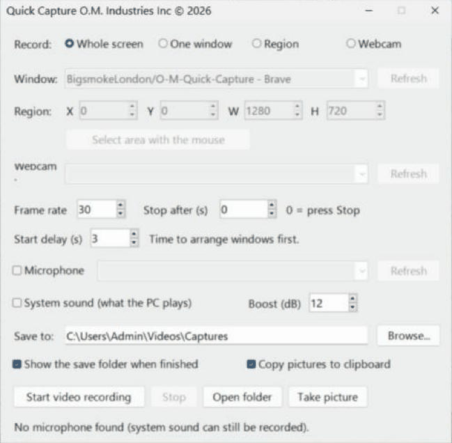
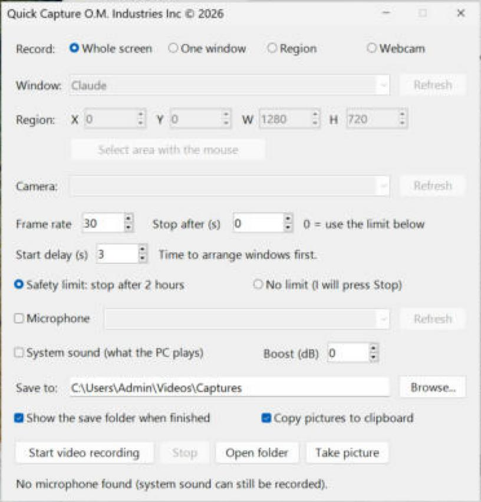
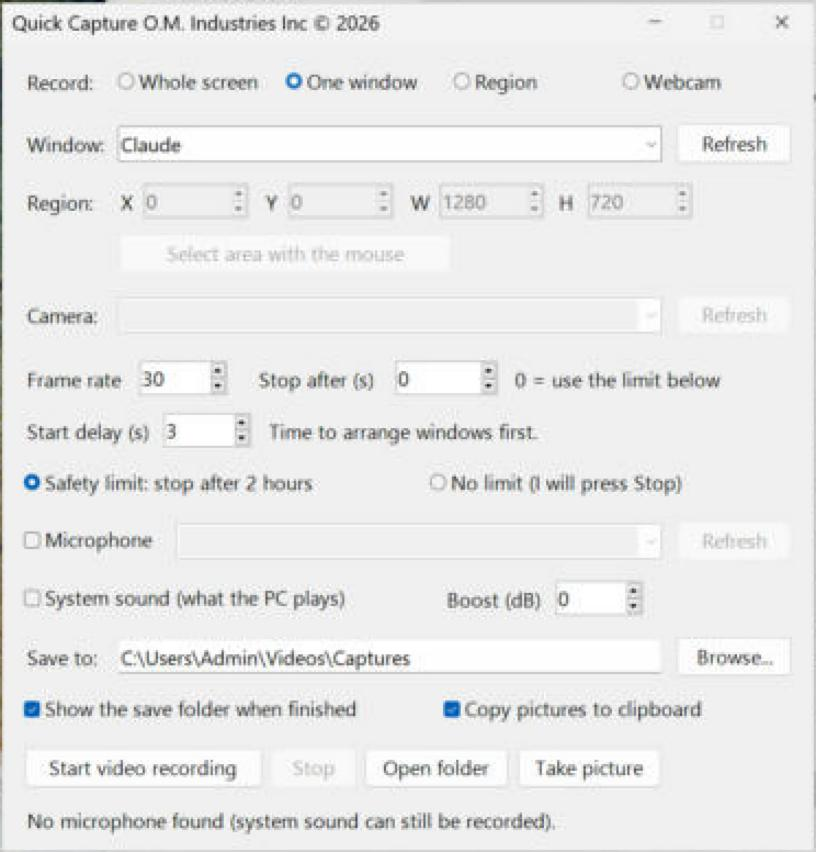
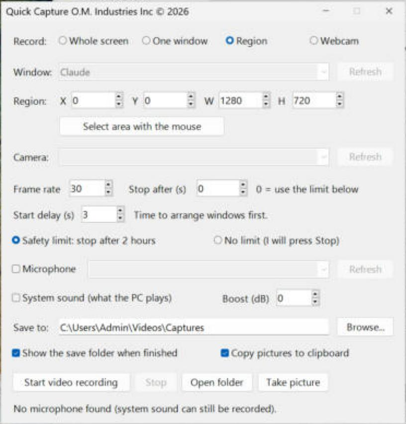
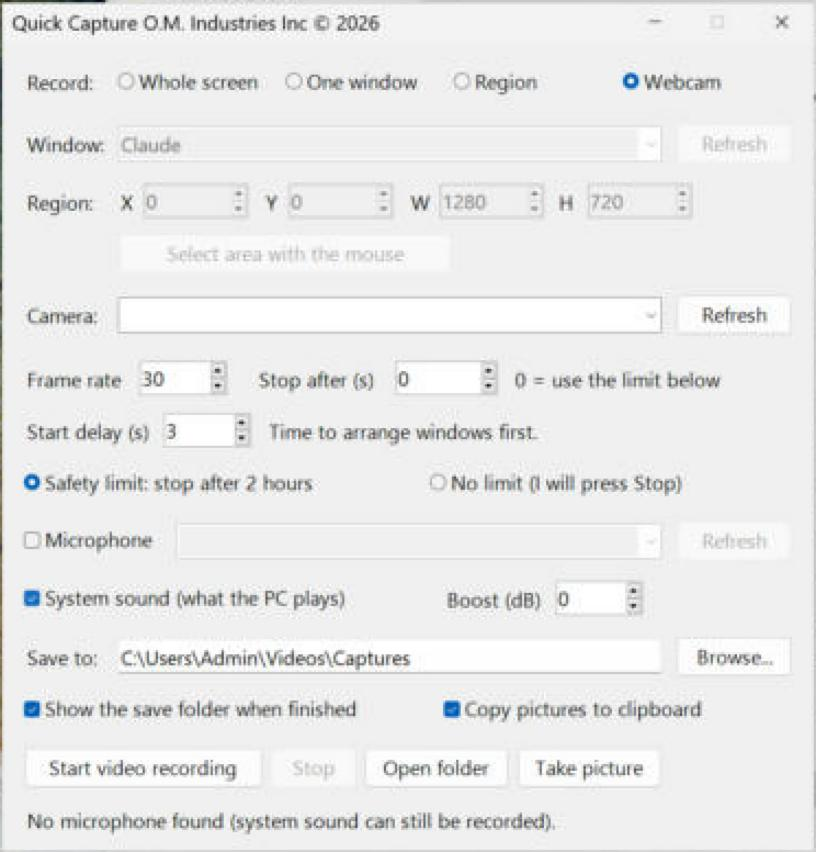
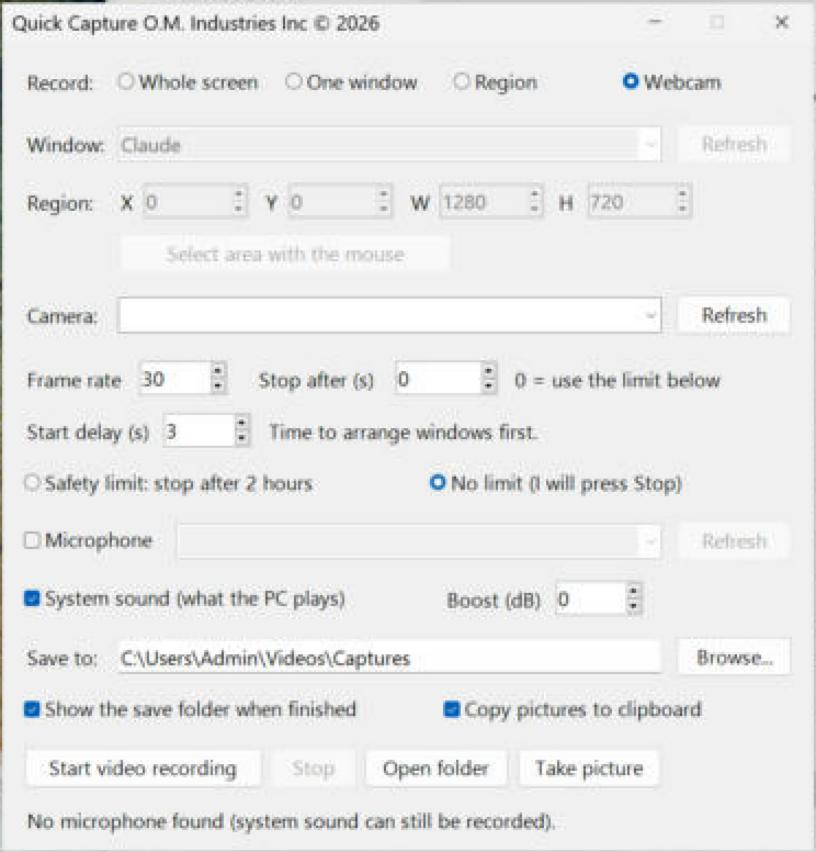
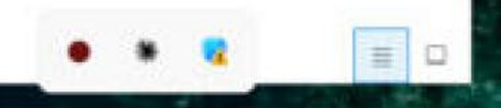

# Quick Capture

Free point-and-click screen recorder for Windows, powered by ffmpeg. Record the whole screen, one window, an area you drag with the mouse, or your webcam, with system sound and microphone if you want them. Take still pictures too. No commands to learn.

From **O.M. Industries Inc**, the makers of [O.M. Video Studio](https://github.com/BigsmokeLondon/OM-Video-Studio). Quick Capture is a separate, standalone tool.

## Screenshots

| Pick what to record | Record one window | Drag a region | Sound |
|---|---|---|---|
|  |  |  |  |

| Safety limit | Red tray icon while recording |
|---|---|
|  |  |

## What it does

- **Whole screen, One window, Region or Webcam.** For Region, press **Select area with the mouse**, drag over the area, and X, Y, width and height fill in. Window mode records the window's screen area, so it also works for modern apps such as Calculator and Settings that record black with other tools.
- **Sound.** Tick **Microphone** for your voice and **System sound** for what the PC plays (built-in Windows loopback, no Stereo Mix or virtual cable needed). **Boost (dB)** lifts quiet system sound. If System sound is not ticked, starting a video asks whether you want it.
- **Take picture.** An instant PNG of the screen, a window or a region, optionally copied to the clipboard.
- **Timing.** Frame rate, **Stop after** (seconds, 0 = press Stop) and a **Start delay** to arrange your windows first.
- **Safety limit.** Recordings stop by themselves after 2 hours so a forgotten recording cannot fill your disk, with a tray warning one minute before. It also stops and saves the video if the disk is nearly full (under 1 GB free), and reminds you from the tray every 15 minutes that it is still recording. Choose **No limit** if you want to press Stop yourself, or set your own time in **Stop after**.
- **Tray icon while recording.** The window hides and a blinking red icon appears in the system tray. Hover it for the elapsed time. Double-click it to stop, or right-click for *Stop recording* and *Show Quick Capture*.
- **Warnings that help.** Webcam chosen but no camera found? It tells you before it starts, for videos and pictures.
- **Tidy results.** Videos are saved as `capture_<date>_<time>.mp4` and pictures as `picture_<date>_<time>.png` in the folder you choose (default `Videos\Captures`). When it finishes, the save folder comes to the front, or opens if it was closed.
- **ffmpeg is the only requirement.** If it is missing, Quick Capture offers to download and install it for you (about 100 MB, one time).

## Install (Windows 10/11)

1. Go to **[Releases](../../releases/latest)** and download **`QuickCapture_Setup.exe`**.
2. Run it. No admin rights needed, and **you do not need Python**.
   - Windows may show *"Windows protected your PC"* because the app is not code-signed. Click **More info → Run anyway**.
3. Launch **Quick Capture** from the Start Menu or the Desktop shortcut.

Prefer no installer? Download this repository as a zip, unzip it anywhere and double-click `Quick_Capture_GUI.bat` (keep `Quick_Capture_GUI.ps1` beside it).

## Videos

- [Quick Capture tutorial](docs/videos/01-tutorial-mobile.mp4): 1 min 55 s, portrait. Every option explained, with a British English voiceover and no captions.

Video files are best downloaded and played locally; GitHub may not stream them inline. More in [docs/videos](docs/videos/README.md).

## Notes

- Recordings are made to `%TEMP%\QuickCapture` first and then finished into your save folder. If Windows *Controlled folder access* blocks the save folder, the video stays in the temp folder and a message tells you where.
- Window mode needs the window to stay visible and uncovered while recording.
- If a recording is ever left running in the background, Quick Capture notices at the next start-up and offers to end it.
- Only record what you own or are entitled to record.
- Uninstall from Windows Settings → Apps.
- The older command-window version, `Quick_Capture.bat`, is still included as a fallback. Usage notes are in [QUICK_CAPTURE.md](QUICK_CAPTURE.md).

## Build the installer

On Windows, double-click `Build_Setup.bat`. It uses the built-in IExpress tool to make one file, `QuickCapture_Setup.exe`, next to the script.

To publish it on GitHub, bump `$version` in `Install_Quick_Capture.ps1`, then either push a tag such as `v1.1.0` or run the **Build installer** workflow by hand from the Actions tab. It builds the installer and attaches it to the release.

## Licence

App code: MIT (see `LICENSE`). ffmpeg is a separate project with its own licence; it is downloaded from its official build providers and is not included here.
